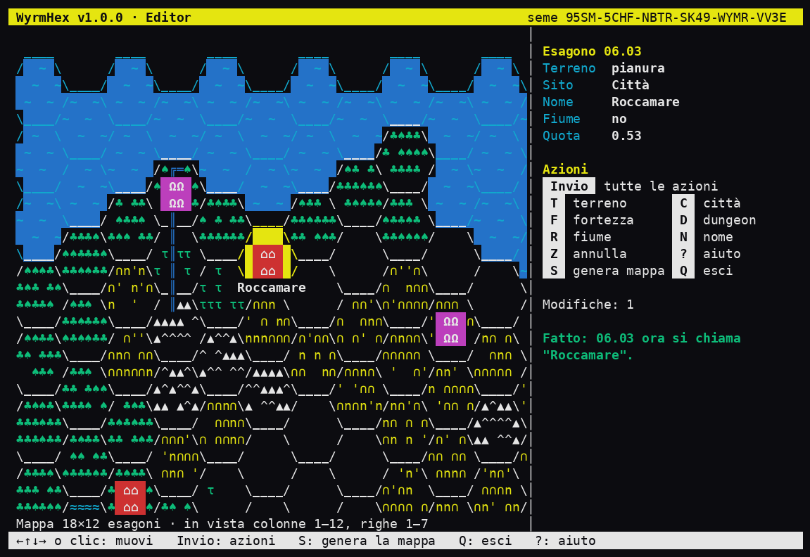
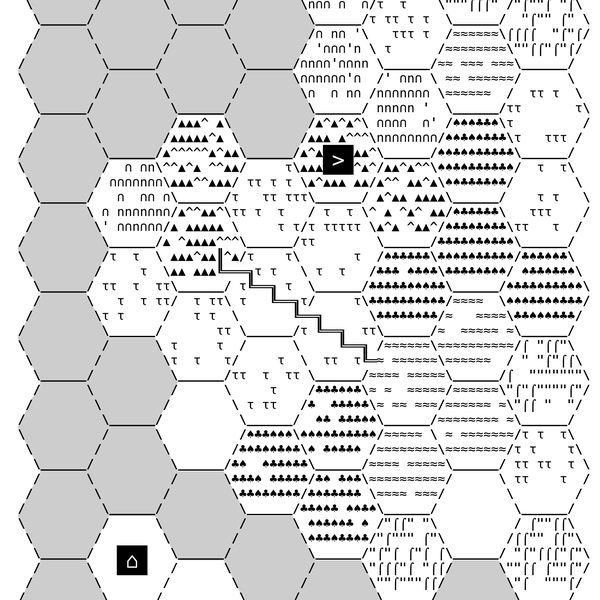
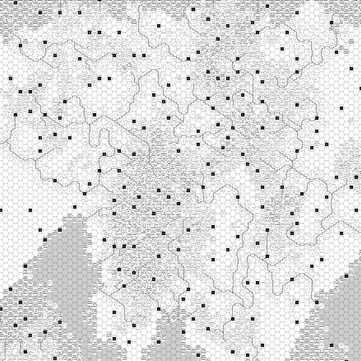
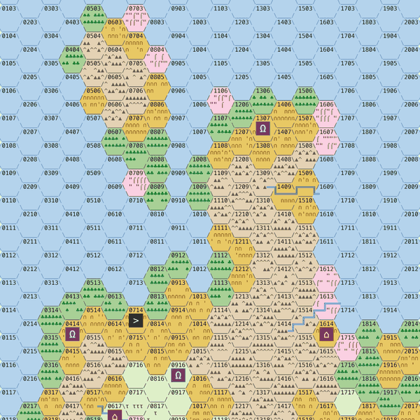
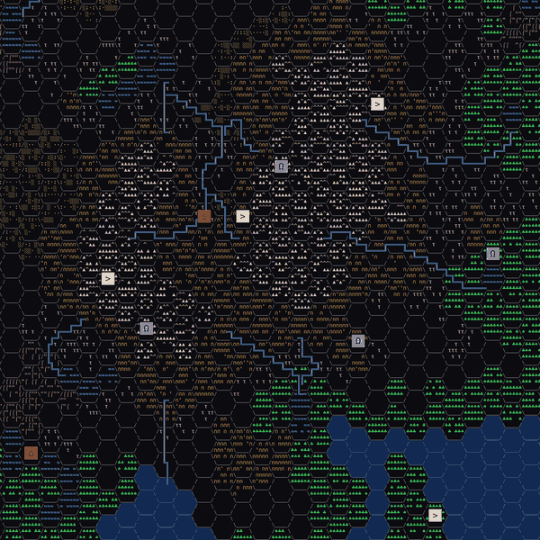

# WyrmHex

<div align="center">

**Italiano** · [English](README.md)

</div>

<table align="center"><tr><td><pre>
        \ ___                     \       /   /)                 ___ /
         \    \_______________     \\ _ //   // _______________/    /
          \      //-  -    / \\__,- .\ /. -,((_// \   -  - \\      /
           \    //   ****************) (*****************   \\    /
            \  //   /****************,_,*****************\   \\  /
             \// __/ *             WyrmHex              * \__ \\/
             /       *              v1.2.0              *       \
                     *************M********M*************
&nbsp;
                                                |&gt;&gt;&gt;
                                                |
                                            _  _|_  _
                                           |;|_|;|_|;|
                                           \\.    .  /
                                            \\:  .  /
                                             ||:   |
                                             ||:.  |
                                             ||:  .|
                                             ||:   |       \,/
                                             ||: , |            /`\
                                             ||:   |
                                             ||: . |
              __                            _||_   |
     ____--`~    '--~~__            __ ----~    ~`---,              ___
-~--~                   ~---__ ,--~'                  ~~----_____-~'   `~----~~
</pre></td></tr></table>

<div align="center">

<br>
Compatibile con qualunque gioco di ruolo analogico "OSR".

Mappe di varie dimensioni nella [Galleria Mappe](#10-galleria-mappe).

</div>

**WyrmHex** è un piccolo programma che disegna a caso una mappa a esagoni per campagne di gioco di ruolo old school (OSR). La mappa è fatta solo di lettere e simboli, come nei videogiochi Dwarf Fortress, ADOM, NetHack o Caves of Qud:

- **foreste** `♣♠`, **montagne** `▲^`, **colline** `∩n`, **deserti** `░·`, **laghi** `≈`, **paludi** `⌠"` (canne e ciuffi d'erba palustre, come in Dwarf Fortress) e, se le chiedi, **foreste di funghi giganti** `⊤°` (cappelli giganti e spore);
- la **pianura** resta vuota, tranne quella **coltivabile**, segnata da qualche germoglio `τ`, e il **mare** è una campitura grigia;
- i **fiumi** sono doppie linee `═║╔╗`;
- **città**, **fortezze** e **dungeon** sono riquadri neri con un simbolo bianco.

La mappa esce in nero su sfondo bianco, pronta da stampare su un foglio **A4, A3 o A2** a 600 dpi, oppure, se preferisci, **a colori** su sfondo bianco o nero: il programma ti consiglia il formato più adatto al numero di esagoni e gira il foglio in verticale o in orizzontale da solo, secondo la forma della mappa. Ogni volta ottieni due immagini della stessa mappa: una **senza numeri** (da mostrare ai giocatori) e una **con il numero in ogni esagono** (per il master).

---

## 1. Cosa ti serve

Metti questi file nella **stessa cartella**, per esempio una cartella `mappe` sul Desktop:

- `wyrmhex.py` (il programma)
- `requirements.txt`
- `README.it.md` (questa guida) e `README.md` (la stessa guida in inglese)

Non serve creare altro: la cartella `maps_generated`, dove finiscono le mappe, la crea il programma la prima volta che lo usi.

Ti serve anche **Python 3.14**, il programma che fa funzionare i file `.py`. Vanno bene anche versioni un po' più vecchie, dalla 3.11 in su.

---

## 2. Installazione

### Passo 1 — Installa Python

- **Windows e macOS:** vai su <https://www.python.org/downloads/>, scarica Python 3.14 e installalo come un normale programma.
  - Su Windows, se durante l'installazione compare la casella **"Add python.exe to PATH"**, spuntala.
- **Linux:** Python di solito è già installato. Se la tua distribuzione non ha la 3.14, va bene anche la versione che hai, purché sia la 3.11 o successiva.

### Passo 2 — Apri il terminale nella cartella dei file

Il terminale è una finestra in cui si scrivono comandi.

- **Windows 11:** apri la cartella `mappe`, fai clic destro in uno spazio vuoto e scegli **"Apri nel Terminale"**.
- **Windows 10:** apri la cartella `mappe`, fai clic sulla barra dell'indirizzo in alto, scrivi `cmd` e premi Invio.
- **macOS:** apri l'app **Terminale** (in Applicazioni → Utility). Scrivi `cd` seguito da uno spazio, trascina la cartella `mappe` dentro la finestra e premi Invio.
- **Linux:** apri la cartella, fai clic destro in uno spazio vuoto e scegli **"Apri nel terminale"**.

### Passo 3 — Crea l'ambiente virtuale

Il programma ha uno spazio riservato dentro la cartella, chiamato *ambiente virtuale*: una sottocartella nascosta `.venv`, che non devi toccare. Così le librerie che gli servono non si mescolano con il resto del computer. Scrivi:

**Windows**
```
py -m venv .venv
```

**macOS e Linux**
```
python3 -m venv .venv
```

Sullo schermo non compare nulla: è normale. Si fa una volta sola.

### Passo 4 — Attiva l'ambiente virtuale

Attivarlo dice al terminale di usare il Python che sta dentro `.venv`. Scrivi:

**Windows**
```
.venv\Scripts\activate
```

**macOS e Linux**
```
source .venv/bin/activate
```

Da qui in poi la riga in cui scrivi comincia con `(.venv)`: è il segno che è attivo. Va attivato di nuovo ogni volta che apri un nuovo terminale (vedi il capitolo 3).

### Passo 5 — Installa le librerie

Con l'ambiente virtuale attivo, scarica **Pillow**, la libreria che serve a creare le immagini, **asciimatics**, quella che disegna i menu da scorrere con le frecce, e **fpdf2**, quella che scrive il PDF con i contenuti della landa (capitolo 6). Il comando è uguale su tutti i sistemi (su Windows installa da solo anche `pywin32`, che serve ad asciimatics):

```
pip install -r requirements.txt
```

Se alla fine compare una riga che inizia con `Successfully installed`, è tutto pronto. Si fa una volta sola.

---

## 3. Creare una mappa

Apri il terminale nella cartella, come al passo 2. Prima attiva l'ambiente virtuale (come al passo 4), poi avvia il programma:

**Windows**
```
.venv\Scripts\activate
python wyrmhex.py
```

**macOS e Linux**
```
source .venv/bin/activate
python wyrmhex.py
```

Basta attivarlo una volta ogni volta che apri un terminale: finché la riga comincia con `(.venv)` è attivo, e puoi fare tutte le mappe che vuoi con `python wyrmhex.py`. Quando hai finito, scrivi `deactivate` o chiudi semplicemente il terminale. Se hai appena finito l'installazione nella stessa finestra, l'ambiente è già attivo.

Per prima cosa il programma ti chiede la **lingua**: scegli **Italiano** o **English** (con Invio resta l'italiano). Da lì in poi domande, messaggi e anche i testi stampati sulla mappa (legenda, scala, titolo di partenza) sono nella lingua scelta.

Poi compare la schermata di benvenuto, con un drago che regge il cartello con il nome del programma e, sotto, una torre di guardia: premi **INVIO** per cominciare. Il programma ti fa alcune domande. Quando ci sono delle scelte, compare un **menu**: muoviti con le frecce **↑ ↓** e conferma con **Invio** (puoi anche premere il numero della scelta, o farci clic sopra). Le altre domande, come i numeri o il titolo, si rispondono scrivendo. **Ogni domanda ha una risposta già pronta, evidenziata nel menu oppure tra parentesi quadre: se ti va bene, premi solo Invio.** Dalla prima domanda alla fine tutto avviene in un'unica finestra a schermo intero: menu, domande, avanzamento del lavoro ed editor. Con **PagSu** e **PagGiù** scorri quello che è già passato. Alla fine premi Invio per chiuderla: tutto quello che c'era scritto resta nel terminale.

1. **Cosa vuoi fare?** Scegli **creare una mappa nuova**, **riprodurre una mappa già fatta** (vedi il capitolo 4) oppure **modificare una mappa** a mano, esagono per esagono (vedi il capitolo 5). Se crei una mappa nuova, il programma ti chiede subito se vuoi anche le **foreste di funghi giganti**, ispirate a Morrowind: crescono a boschetti, al posto di una parte delle foreste, solo nei luoghi più umidi: dove il vento porta più pioggia, accanto a mare, laghi, paludi e fiumi, e nelle terre basse dove l'acqua ristagna. La risposta pronta è **solo terreni realistici**, cioè no: in quel caso la mappa viene generata esattamente come sempre, con lo stesso seme. Se rispondi sì, alla domanda 5 trovi anche la loro percentuale (6% già pronto, preso dalle foreste) e con i valori a caso ne ricevi fra il 3 e il 12%. Nel PDF dei contenuti le foreste di funghi hanno la loro tabella degli incontri (dalla tabella delle caverne di *Hexcrawl Horrors*: muffe, funghi e creature del buio) e una riga nella storia della landa.

   Subito dopo ti chiede come **numerare gli esagoni** sulla mappa per il master: **come negli hexcrawl** (la risposta pronta), con il codice di colonna e riga dentro ogni esagono, per esempio `0307`; oppure **come a battaglia navale**, con le lettere delle righe sul bordo sinistro della mappa e i numeri delle colonne sul bordo in alto, così l'esagono della riga G e della colonna 3 è `G3`. Le lettere sono le 21 dell'alfabeto italiano (in inglese da A a U), quindi con la battaglia navale la mappa ha al massimo **21 righe**; con `auto` il programma ne tiene conto da solo. Le colonne dispari stanno mezzo esagono più in alto delle pari: la lettera è all'altezza della prima colonna. Nel PDF dei contenuti, nell'elenco dei siti e nell'editor gli esagoni si chiamano allo stesso modo.
2. **Esagoni in base e in altezza:** quante colonne e quante righe di esagoni vuoi. La risposta pronta è `auto`: il programma sceglie da solo quanti esagoni riempiono un foglio A4 restando leggibili (33 × 15).
3. **Scegli tu o a caso?** Scegli **li scelgo io** per rispondere tu alle tre domande successive, oppure **a caso** per far scegliere al programma a caso il numero di siti, le percentuali di terreno e i fiumi, in proporzione alla mappa. Con **a caso** passa direttamente al titolo. I valori scelti vengono mostrati mentre lavora e finiscono nel seme come tutti gli altri.
4. **Numero di dungeon, città e fortezze** da mettere sulla mappa (fino a 99 per tipo).
5. **Percentuali di terreno:** quanta parte della mappa è pianura, mare, laghi, paludi, colline, montagne, foreste e deserti, in numeri interi. Le paludi nascono nelle zone basse, soprattutto lungo la costa e attorno ai laghi. Se il mare supera il 50%, la mappa diventa una costa frastagliata: una terraferma lungo un lato, con penisole che si allungano nel mare e baie tra l'una e l'altra, e isole al largo. Oltre l'80% di mare la terraferma sparisce e resta un arcipelago di isole. Il programma calcola anche la **salinità del terreno**: il sale arriva dal mare, sulle terre basse vicino alla costa, e dalle zone basse e asciutte, dove l'acqua evapora e lo lascia lì; la pioggia, i fiumi e i laghi lo portano via. Lungo la costa nascono così paludi salmastre, mentre all'interno le paludi stanno dove l'acqua è dolce e non nelle conche salate e aride. Le pianure abbastanza dolci diventano **pianure coltivabili** e le città le preferiscono; quelle salate restano incolte. Ogni mappa ha anche un **vento prevalente**, scelto a caso e indicato mentre la mappa viene creata (per esempio "da ovest"): porta la pioggia sui versanti delle colline e delle montagne rivolti verso il vento, dove crescono le foreste, mentre dall'altra parte dei rilievi il terreno resta secco e lì si formano più facilmente i deserti. La somma non può superare 100; se resta qualcosa, diventa pianura. Se sbagli, il programma te lo dice e ti fa reinserire i numeri.
6. **Numero di fiumi** (fino a 100): con `-1` il programma decide da solo.
7. **Titolo** stampato in cima alla mappa.
8. **Scala:** quante miglia copre ogni esagono: 2, 6 (la risposta pronta), 12 o 24 miglia, oppure **altro, lo scrivo io**: un numero di miglia, oppure un testo qualsiasi come `5 km` o `1 giorno`. Viene stampata sotto il titolo, come "1 esagono = 6 miglia".
9. Se usare **solo i caratteri base della tastiera** (senza simboli come ♣ ▲ ≈). Di solito rispondi no: basta premere Invio.
10. **Colori:** **bianco e nero**, per la stampa (la risposta pronta), oppure **a colori**: foreste verdi, mare e laghi blu, deserti color sabbia, paludi viola, città rosse e così via. Solo per la mappa a colori il programma chiede poi lo **sfondo**: **bianco** o **nero**. Sullo sfondo bianco anche gli esagoni sono colorati, per leggere la mappa a colpo d'occhio: verde chiaro le pianure, verde più scuro le foreste, rosa le paludi, giallo il deserto, giallo più scuro le colline, beige le montagne, azzurro il mare e i laghi (i laghi si riconoscono dai simboli `≈`).
11. **Cosa vuoi generare?** Tre scelte: **solo la mappa** (la risposta pronta); **la mappa e il contenuto degli esagoni, a caso**, cioè le tabelle degli incontri casuali per i terreni della mappa e l'elenco di tutti gli esagoni popolati; oppure **la mappa, il contenuto degli esagoni e la storia della landa**, con le voci che girano nelle taverne. Tutto finisce in un PDF accanto alla mappa (vedi il capitolo 6). Se chiedi il contenuto degli esagoni, il programma ti chiede anche **quanti esagoni di terra lasciare vuoti**, da riempire tu al tavolo: una percentuale da 0 a 100, oppure `auto` (la risposta pronta) per farla scegliere a caso fra 20 e 30. I contenuti si basano sulla mappa e sul seme: la stessa mappa dà sempre gli stessi contenuti, e chiederli non cambia la mappa.
12. **Nomi di città, fortezze e dungeon:** **li scrivo io, quando la mappa è pronta**, **li sceglie il programma a caso** (nomi come "Fonte Bianca" o "Forte del Tramonto", nella lingua scelta) oppure **nessun nome**. La risposta pronta è "li scrivo io"; se nella domanda 3 hai scelto i valori a caso, è "nessun nome". I nomi a caso vanno bene anche se generi solo la mappa.

Finite le domande compare un mago con la scritta **"L'incantesimo di evocazione ha inizio!"** (in inglese: *"The conjuring spell begins!"*): da qui il programma si mette al lavoro.

Mentre lavora, mostra i passaggi che sta facendo, ognuno con una **barra di avanzamento** che si riempie passo dopo passo:

```
[████░░░░░░░░]  4/12  Mare: allagamento dall'esagono di bordo più basso verso le quote minori
```

Durante il disegno delle due immagini, che è la parte più lunga, compare anche una seconda barra con la percentuale, che si aggiorna sul posto fino a `100%  fatto`. Quando la mappa è pronta ti chiede le ultime cose:

13. **Nomi dei siti** (solo se alla domanda 12 hai scelto "li scrivo io"): per ogni città, fortezza e dungeon il programma ti dice in che esagono si trova e su che terreno, e ti chiede se vuoi dargli un nome, per esempio `Città 1, esagono 2712 (colline). Vuoi dare un nome? (s/N)`. Se rispondi `s`, scrivi il nome (fino a 24 caratteri): compare in grassetto sulla mappa, sotto il simbolo del sito. Premi Invio per lasciare il sito senza nome.
14. **Formato di stampa** delle due mappe: `A4`, `A3` o `A2`. Il programma valuta il formato in base al numero di esagoni: prima della domanda vedi, per ogni formato, quanto verranno grandi gli esagoni e i caratteri, e se saranno ben leggibili. La risposta pronta, già evidenziata nel menu, è il **formato consigliato**, cioè il più piccolo in cui la mappa si legge bene; più esagoni hai scelto, più grande sarà. **La scelta finale è tua:** premi Invio per il formato consigliato, oppure spostati su un altro. Esempio:

   ```
   Griglia di 12 x 30 esagoni: ecco come verrebbe stampata su ogni formato (esagono misurato da
   lato piatto a lato piatto)

   Formato di stampa per le due mappe (la scelta finale è tua):

       1  A4 verticale, esagoni piccoli 8 mm, caratteri 1.07 mm (troppo piccoli)
    ▶  2  A3 verticale, esagoni piccoli 12 mm, caratteri 1.53 mm (ben leggibili)  ← consigliato
       3  A2 verticale, esagoni grandi 18 mm, caratteri 1.50 mm (ben leggibili)
   ```

   Sui fogli grandi, se c'è spazio, il programma usa esagoni più grandi, così la mappa resta ben proporzionata.

Alla fine elenca dove sono le città, le fortezze e i dungeon, con il numero del loro esagono e il loro nome, se gliel'hai dato: comodo per gli appunti del master.

Per ultima cosa ti chiede se vuoi **modificare questa mappa adesso**. Rispondi `s` per passare subito all'editor (capitolo 5) senza rifare la mappa: la versione modificata viene salvata accanto all'originale, nello stesso formato.

---

## 4. Rifare una mappa già fatta

Ogni mappa ha un **seme**: un codice di 24 lettere e cifre a gruppi di quattro, come `475T-4KM4-MY0B-JNDJ-ZYEQ-K164`. Il programma lo mostra mentre lavora e lo stampa sotto il titolo della mappa. È anche il nome della cartella della mappa dentro `maps_generated` e l'inizio del nome dei suoi file.

Il seme contiene tutto ciò che dà forma alla terra: il numero di esagoni, le città, le fortezze e i dungeon, le percentuali di terreno, i fiumi e tutte le scelte casuali. Per questo **lo stesso seme dà sempre la stessa mappa**, su qualunque computer, anche se i file della mappa non ci sono più. Per condividere una mappa con qualcuno basta dargli il suo seme.

Per rifare una mappa, avvia il programma, scegli la lingua, alla domanda "Cosa vuoi fare?" scegli **riprodurre una mappa già fatta** e scrivi il seme. Maiuscole, trattini e spazi non contano, e se sbagli un carattere il programma te lo dice, invece di fare in silenzio una mappa diversa. Poi ti mostra il titolo e la scala attuali della mappa e ti chiede se vuoi **rinominare la mappa** e se vuoi **cambiare la scala** (miglia per esagono: le stesse scelte della mappa nuova, più la possibilità di lasciare com'è una scala scritta a mano). Basta premere Invio per lasciarli come sono. Se la mappa ha al massimo 21 righe, ti chiede anche come **numerare gli esagoni** (hexcrawl o battaglia navale). Ti chiede anche cosa fare con i **nomi** di città, fortezze e dungeon: **lasciarli come sono**, **scriverli tu** (quando la mappa è pronta ti propone i siti uno per uno, con il nome che hanno già) oppure **farli scegliere al programma a caso**. Poi ti chiede di nuovo se usare i caratteri base, il bianco e nero o i colori, se generare **solo la mappa o anche i suoi contenuti** e, alla fine, il formato di stampa: così puoi rifare la stessa mappa, per esempio, con un altro nome, a 24 miglia per esagono, oppure in A3 invece che in A4.

Il titolo, la scala, i nomi dei siti e il formato di stampa non fanno parte del seme, perché non cambiano la terra. Se il PNG della mappa è ancora nella sua cartella `maps_generated/<seme>`, il programma li prende da lì (il formato diventa la risposta pronta); altrimenti usa il titolo e la scala di partenza. Da riga di comando puoi sceglierli tu, per esempio `--riproduci <seme> --titolo "Terre del Nord"`.

Se rifai la mappa in una lingua diversa da quella della prima volta, il titolo e la scala di partenza vengono tradotti (per esempio "Terre Selvagge" diventa "Wild Lands"); un titolo scelto da te resta com'è.

La mappa rifatta finisce nella cartella `maps_generated/<seme>` e sostituisce i file che c'erano. Le lettere sono disegnate con un carattere trovato sul tuo computer: su un altro computer possono avere un aspetto un po' diverso, ma esagoni, terreni, fiumi e siti sono identici.

**Mappe fatte con le versioni precedenti.** I primi semi di questo tipo, fatti prima che esistessero le paludi, funzionano ancora: danno la stessa mappa di prima, senza paludi. Lo stesso vale per i semi fatti prima del vento prevalente, di penisole e arcipelaghi o della salinità del terreno: danno la stessa mappa di prima, disposta come allora. Ancora prima il seme era un semplice numero, come `482913`, e funzionava solo insieme alle impostazioni salvate nel PNG della mappa. Puoi ancora scrivere quel numero: se il PNG viene trovato (in `maps_generated/482913` o nella cartella del programma), la mappa torna uguale e riceve un seme del nuovo tipo. Se il PNG non c'è più, il programma ti chiede di reinserire le stesse impostazioni usate la prima volta.

---

## 5. Modificare una mappa

Puoi cambiare a mano una mappa, esagono per esagono, partendo dal suo seme. Se l'hai appena fatta, rispondi `s` quando il programma ti chiede se vuoi modificarla adesso (capitolo 3). Altrimenti avvia il programma, scegli la lingua, alla domanda "Cosa vuoi fare?" scegli **modificare una mappa** e scrivi il seme. Come quando rifai una mappa, ti chiede del titolo, della scala e dell'aspetto; poi costruisce la mappa e apre l'**editor**, che la disegna direttamente nel terminale:



A sinistra c'è la mappa, con i colori dei terreni, i fiumi, i siti e i loro nomi; l'esagono evidenziato in giallo è il **cursore**. A destra vedi cosa c'è in quell'esagono (terreno, sito, nome, se ci passa un fiume e in che direzione scorre) e i tasti delle azioni. Se la mappa non sta tutta nella finestra, la vista scorre da sola seguendo il cursore; sotto la mappa c'è scritto quali colonne e righe stai guardando.

- **Frecce ← ↑ ↓ →** spostano il cursore; puoi anche fare **clic** su un esagono.
- **Invio**, o un clic sull'esagono già scelto, apre il menu con tutto quello che puoi fare lì.
- **T** cambia il terreno: scegli quello nuovo dal riquadro che compare.
- **C**, **F** e **D** mettono o tolgono una città, una fortezza o un dungeon.
- **N** dà un nome al sito dell'esagono, o lo cambia (fino a 24 caratteri; lascialo vuoto per togliere il nome).
- **R** fa nascere un fiume da quell'esagono (lo traccia il programma seguendo la discesa, oppure lo tracci tu) oppure, se ci passa già un fiume, lo toglie tutto, ne sposta quel tratto di un esagono (il programma propone solo le direzioni da cui il fiume non arriva e verso cui non va già: se scorre da nord a sud, nord e sud non compaiono) o lo accorcia in modo che finisca o nasca proprio lì.
- **Z** annulla l'ultima modifica: puoi annullarne più d'una, una alla volta.
- **S** genera la mappa con le modifiche.
- **Q** esce senza generare la mappa: le modifiche restano salvate.
- **?** mostra l'aiuto con tutti i tasti.

Nei riquadri che compaiono sopra la mappa ti muovi con **↑ ↓** e confermi con **Invio** (o con il numero della scelta, o con un clic); **Esc** chiude il riquadro senza cambiare niente. Il pannello a destra conferma ogni modifica e conta quante ne hai fatte, e quando l'editor si chiude l'elenco delle modifiche resta scritto nel terminale.

Per **tracciare tu un fiume** scegli i suoi esagoni sulla mappa, uno dopo l'altro: porta il cursore su un esagono vicino all'ultimo e premi Invio (o fai clic): il fiume ci passa, e il percorso si colora. Un esagono di mare o di lago lo fa sfociare lì, un esagono di un altro fiume lo fa confluire in quello; **F** lo fa finire dove sei arrivato. **Backspace** toglie l'ultimo esagono scelto, **Esc** rinuncia al fiume.

Visto che i nomi dei siti si danno nell'editor, con **N**, quando modifichi una mappa il programma non ti chiede i nomi a parte.

### L'editor a domande

Se il terminale è troppo piccolo (servono almeno 80 colonne e 24 righe) o non è un terminale vero (capitolo 9), l'editor funziona a domande, con le stesse azioni. Il programma mostra una tabella con una riga per ogni esagono:

```
  Esagono  Terreno   Dungeon  Città  Fiume  Direzione  Fortezza
  -------  --------  -------  -----  -----  ---------  --------
  03.07    foresta   -        -      sì     sud        -
```

La direzione è quella verso cui scorre il fiume da quell'esagono. Gli esagoni hanno il lato piatto in alto, quindi le sei direzioni sono nord, nord-est, sud-est, sud, sud-ovest e nord-ovest: est e ovest "puri" non esistono.

Sulle mappe con più di 80 esagoni la tabella mostra solo gli esagoni con siti, fiumi o modifiche, più quelli intorno all'esagono appena modificato, così non riempie lo schermo. Scrivi `T` al posto dell'esagono per vedere la tabella completa.

Poi:

1. Scrivi l'esagono da cambiare come colonna.riga, per esempio `03.07` (vanno bene anche `3.7` e `0307`); con la numerazione a battaglia navale, come lettera della riga e colonna, per esempio `G3`.
2. Scegli cosa farne: cambiare il terreno; aggiungere o togliere un dungeon, una città o una fortezza; aggiungere un fiume che nasce da quell'esagono (lo traccia il programma seguendo la discesa, oppure lo tracci tu) oppure, se ci passa già un fiume, toglierlo tutto, spostare quel tratto di un esagono (il programma propone solo le direzioni da cui il fiume non arriva e verso cui non va già: se scorre da nord a sud, nord e sud non compaiono), o accorciarlo in modo che finisca o nasca proprio lì.
3. La tabella ricompare, aggiornata. Scegli se cambiare un altro esagono, generare la mappa con le modifiche, **annullare** l'ultima modifica (puoi annullarne più d'una, una alla volta) o **uscire** senza generare la mappa.

Quando ti chiede l'esagono puoi anche scrivere `T` (tabella completa), `A` (annulla l'ultima modifica) o `E` (esci). In inglese sono `T`, `U` e `Q`. Un fiume tracciato a mano qui si scrive: gli esagoni dopo la sorgente, in ordine e separati da spazi, per esempio `03.08 04.08 05.09`. In questo caso i nomi dei siti non si danno nell'editor: il programma ti chiede se vuoi darli e poi te li propone uno per uno, come quando rifai una mappa (capitolo 4).

### Le regole

Alcune regole tengono la mappa coerente, in tutti e due gli editor:

- In un esagono c'è al massimo un sito: se aggiungi una città dove c'è un dungeon, la città prende il suo posto.
- Siti e fiumi non possono nascere sul mare o sui laghi. Se trasformi un esagono in acqua, il suo sito viene tolto e il fiume che ci passava ora finisce lì.
- Un tratto di fiume spostato viene ricollegato al resto attraverso gli esagoni vicini. Se non si può (c'è acqua o un altro fiume, oppure il fiume si spezzerebbe), il programma te lo dice e non cambia nulla.
- Un fiume nuovo tracciato dal programma scende verso il basso come gli altri. Le altezze seguono le tue modifiche: se hai trasformato una pianura in montagna, il fiume parte alto come le altre montagne della mappa.
- In pianura spesso il programma non trova una strada in discesa. In quel caso ti propone di **tracciare il fiume tu**, cosa che puoi anche scegliere fin da subito. Ogni esagono deve toccare quello prima. Per farlo sfociare, finiscilo con un esagono di mare o di lago; per farlo confluire in un altro fiume, con un esagono di quel fiume. Altrimenti finisce nell'ultimo esagono che hai scelto (o esce dalla mappa, se quell'esagono è sul bordo).
- Se una modifica cambia il modo in cui finisce *un altro* fiume (hai riempito il lago in cui sfociava, o tolto il fiume in cui confluiva), il programma te lo dice con una nota, per esempio "il fiume che nasce in 09.08 ora finisce in 08.06 senza arrivare all'acqua". Con "annulla" torna com'era.
- Tutto quello che non hai toccato resta identico alla mappa originale.

La mappa modificata viene salvata nella stessa cartella dell'originale, che resta com'è: `<seme>_edit_nonumber.png` e `<seme>_edit_number.png` (più i .txt), con "(modificata)" dopo il seme sotto il titolo. Le modifiche, compresi i nomi dati ai siti nell'editor, vengono salvate in `<seme>_edit.json` dopo ogni singolo cambiamento, così non le perdi se esci o chiudi il programma a metà. Il seme da solo dà sempre la mappa originale, ma se scegli di nuovo `3` con lo stesso seme, il programma ti propone di riprendere le modifiche salvate: puoi continuare a modificare, oppure rigenerare subito la mappa modificata, per esempio in un altro formato o a colori.

Le modifiche sono conservate anche dentro il PNG modificato: se `<seme>_edit.json` va perso, il programma le ritrova lì. E se rifai una mappa che ha una versione modificata (**riprodurre una mappa già fatta**, oppure `--riproduci`), il programma ti ricorda che la versione modificata esiste e come ottenerla.

`<seme>_edit.json` è un file di testo, quindi puoi anche cambiarlo a mano. Quando lo legge, il programma salta quello che non ha senso (un esagono fuori dalla mappa, una città sul mare, un fiume con un buco) e ti dice quante voci ha saltato. Se il file non si legge proprio, il programma non ci scrive sopra: lo rinomina `<seme>_edit_broken.json`, così non va perso, e riparte dalle modifiche nel PNG modificato oppure, se non ci sono, dalla mappa originale.

L'editor si apre solo avviando il programma senza opzioni. Una volta salvate le modifiche, però, puoi rifare la mappa modificata anche da riga di comando con `--riproduci <seme> --modificata` (capitolo 8), per esempio in un altro formato o a colori.

---

## 6. I file che ottieni

La prima volta che lo usi, il programma crea accanto a `wyrmhex.py` una cartella chiamata **`maps_generated`**. Ogni mappa ha lì dentro una cartella tutta sua, che ha per nome il seme della mappa (vedi il capitolo 4), con dentro i suoi quattro file:

```
maps_generated/
  475T-4KM4-MY0B-JNDJ-ZYEQ-K164/
    475T-4KM4-MY0B-JNDJ-ZYEQ-K164_nonumber.png
    475T-4KM4-MY0B-JNDJ-ZYEQ-K164_nonumber.txt
    475T-4KM4-MY0B-JNDJ-ZYEQ-K164_number.png
    475T-4KM4-MY0B-JNDJ-ZYEQ-K164_number.txt
```

Alla fine il programma ti dice in quale cartella ha messo i file.

| File | Cos'è |
|---|---|
| `<seme>_nonumber.png` | La mappa senza numeri, per i giocatori |
| `<seme>_number.png` | La stessa mappa con il numero in ogni esagono (o, con la numerazione a battaglia navale, le lettere e i numeri sui bordi), per il master |
| `<seme>_nonumber.txt`, `<seme>_number.txt` | La mappa come testo, apribile con il Blocco note |
| `<seme>_edit_…`, `<seme>_edit.json` | Solo se hai modificato la mappa (capitolo 5): la mappa modificata e l'elenco delle modifiche |
| `<seme>_contents.pdf`, `<seme>_contents.json` | Solo se hai chiesto anche i contenuti: il PDF da stampare per il master, e gli stessi contenuti in un file di testo (per una mappa modificata, `<seme>_edit_contents…`) |

I numeri degli esagoni hanno quattro cifre: le prime due indicano la colonna, le ultime due la riga. `0101` è l'esagono in alto a sinistra; `0305` è nella terza colonna, quinta riga.

### Il PDF dei contenuti

Se alla domanda 11 hai scelto anche il contenuto degli esagoni (o hai usato `--contenuti` o `--storia`), accanto alle mappe trovi un PDF in formato A4, nella lingua scelta, con:

- solo se hai chiesto anche la storia (`--storia`): **la storia della landa**, ogni volta diversa nella forma e nei contenuti: a volte una cronaca, a volte un racconto che parte da oggi e torna indietro, a volte una leggenda narrata. Parla del regno che c'era una volta, del suo sovrano più grande e di come è caduto, delle città, delle fortezze e dei dungeon della mappa con il loro esagono, del paesaggio, del mare e dei fiumi, delle fazioni di oggi e dei loro rapporti, della minaccia che incombe e dei suoi presagi. Regni, sovrani, fazioni e dèi hanno nomi inventati sul momento, e le combinazioni possibili sono miliardi;
- solo con la storia: **le voci che girano nelle taverne**, una tabella da 1d20: alcune parlano dei siti della mappa;
- **gli incontri casuali**: una tabella da 1d20 per ogni terreno presente sulla mappa (pianure, foreste, colline, paludi, montagne, deserti), dal più diffuso al meno diffuso. Ogni tabella prende 20 incontri diversi dalla tabella da 1d100 di *Hexcrawl Horrors* per quel terreno, preferendo quelli più frequenti, quindi cambia da una mappa all'altra. Se hai chiesto anche la storia, 6 delle 20 voci sono **eventi e personaggi della storia**: pattuglie, spie ed emissari delle fazioni di oggi, pellegrini alla tomba del sovrano di un tempo, fantasmi e reliquie del regno caduto, fedeli del dio, viandanti diretti alle città o in fuga dai dungeon della mappa. Sono scritte in corsivo, sparse fra i mostri;
- **gli esagoni**: una riga per ogni esagono tranne il mare, con il suo numero, il terreno e il contenuto. Città, fortezze e dungeon hanno il loro nome. Fra gli altri esagoni di terra, la percentuale che hai scelto (oppure **dal 20 al 30%**) resta vuota, da riempire al tavolo con le tue tabelle. Il resto è popolato con la tabella d66 di *Wilderness Stocking – Expanded* di D4Caltrops: **luogo notevole**, **tana**, **speciale**, **pericolo** o **risorsa**, con un suggerimento per l'arbitro. Gli occupanti delle tane (e le tracce) sono tirati sulla tabella degli incontri del terreno che trovi nel PDF. Nelle foreste e nelle montagne alcuni esagoni diventano uno dei **luoghi dettagliati** di D4Caltrops, come "Il Guado Gorgogliante" o "La Rocca Nanica Condannata", descritto per intero nella sua riga, con i dettagli già tirati sulle sue tabelle;

Il file `<seme>_contents.json` contiene le stesse cose in un formato che altri programmi possono leggere. Se fpdf2 non è installato, la mappa viene fatta lo stesso e i contenuti vengono salvati solo nel JSON: il programma te lo dice.

---

## 7. Stampare

Le immagini hanno già la misura esatta del foglio che hai scelto (A4, A3 o A2), a 600 dpi: si stampano nitide anche sui fogli grandi.

- Stampa sul **formato che hai scelto**, con il foglio nello stesso verso dell'immagine (verticale o orizzontale). Le mappe in bianco e nero vanno bene con qualsiasi stampante; quelle a colori richiedono una stampante a colori.
- Una mappa a colori con lo **sfondo nero** consuma moltissimo inchiostro: è pensata per lo schermo (tablet, tavoli virtuali) più che per la carta.
- Nelle opzioni di stampa scegli **"Dimensioni effettive"** o **"100%"**. Evita "Adatta alla pagina", che rimpicciolisce la mappa.
- Se la tua stampante arriva solo all'A4, per A3 e A2 puoi rivolgerti a una copisteria: porta il file PNG così com'è.

---

## 8. Per chi vuole andare più veloce: le opzioni

Invece di rispondere alle domande, puoi scrivere tutto su una riga. Le impostazioni che non scrivi prendono il valore di partenza. Esempi, con l'ambiente virtuale attivo (vedi il capitolo 3):

```
python wyrmhex.py --griglia 30x15 --citta 4 --dungeon 6
python wyrmhex.py --griglia 50x30 --formato A2
python wyrmhex.py --mare 30 --pianura 15 --titolo "Isola dei Venti"
python wyrmhex.py --riproduci 475T-4KM4-MY0B-JNDJ-ZYEQ-K164
python wyrmhex.py --riproduci 475T-4KM4-MY0B-JNDJ-ZYEQ-K164 --modificata --formato A3
python wyrmhex.py --griglia 40x25 --casuale
python wyrmhex.py --casuale --storia --nomi-casuali
python wyrmhex.py --language en --grid 30x15 --cities 4
```

Ogni opzione ha anche un nome inglese (nella tabella dopo la barra `/`), e puoi mescolarli come vuoi. Senza `--lingua` i messaggi e i testi della mappa sono in italiano.

| Opzione | Cosa fa | Esempio |
|---|---|---|
| `--lingua` / `--language` | Lingua dei messaggi e dei testi della mappa: `it` o `en` | `--lingua en` |
| `--griglia` / `--grid` | Colonne x righe di esagoni (`auto` = riempie un A4) | `--griglia 20x15` |
| `--citta`, `--fortezze`, `--dungeon` / `--cities`, `--fortresses`, `--dungeons` | Quanti siti di ogni tipo (da 0 a 99) | `--citta 4` |
| `--pianura`, `--mare`, `--laghi`, `--paludi`, `--colline`, `--montagne`, `--foreste`, `--deserti` / `--plains`, `--sea`, `--lakes`, `--swamps`, `--hills`, `--mountains`, `--forests`, `--deserts` | Percentuale di ogni terreno, in numero intero | `--mare 25` |
| `--funghi` / `--mushrooms` | Percentuale di foreste di funghi giganti (di solito 0: nessuna). Con `--casuale`, un valore qualsiasi sopra 0 le accende e la percentuale la sceglie il programma | `--funghi 6` |
| `--fiumi` / `--rivers` | Numero di fiumi, fino a 100 (`-1` = automatico) | `--fiumi 3` |
| `--casuale` / `--random` | Sceglie a caso il numero di siti, le percentuali di terreno e i fiumi, in proporzione alla mappa. Le opzioni qui sopra per siti, terreni e fiumi vengono ignorate. Con lo stesso numero di `--seme` escono sempre gli stessi valori | `--casuale` |
| `--titolo` / `--title` | Titolo in cima alla mappa | `--titolo "Terre del Nord"` |
| `--scala` / `--scale` | Miglia per esagono: 2, 6 (default), 12, 24 o un altro numero. Va bene anche un testo libero, come `"8 km"` | `--scala 12` |
| `--seme` / `--seed` | Con un seme completo, rifà quella mappa (come `--riproduci`). Con un numero da 0 a 1048575, fa una mappa nuova con le tue impostazioni e quel numero per le scelte casuali | `--seme 42` |
| `--riproduci` / `--reproduce` | Rifà la mappa di quel seme. Titolo, scala e formato vengono dal suo PNG, se è in `maps_generated/<seme>` (o nella cartella di `--output`); un vecchio seme numerico ha bisogno del suo PNG | `--riproduci 475T-4KM4-MY0B-JNDJ-ZYEQ-K164` |
| `--modificata` / `--edited` | Insieme a `--riproduci` (o a `--seme` con un seme completo): rifà la versione modificata della mappa, con le modifiche salvate dall'editor (capitolo 5). Se la mappa non ha modifiche salvate, il programma lo dice e si ferma | `--riproduci <seme> --modificata` |
| `--contenuti` / `--contents` | Genera anche il contenuto degli esagoni, a caso (incontri casuali ed esagoni popolati), in un PDF accanto alla mappa (capitolo 6) | `--contenuti` |
| `--storia` / `--history` | Come `--contenuti`, e in più la storia della landa con le voci di taverna | `--storia` |
| `--vuoti` / `--empty` | Insieme a `--contenuti` o `--storia`: la percentuale di esagoni di terra da lasciare vuoti per le tue tabelle, da 0 a 100. Senza, è a caso fra 20 e 30 | `--vuoti 40` |
| `--nomi-casuali` / `--random-names` | Dà a città, fortezze e dungeon nomi scelti a caso | `--nomi-casuali` |
| `--numerazione` / `--numbering` | Come numerare gli esagoni sulla mappa per il master: `standard` (il codice `0307` in ogni esagono, la scelta di sempre) oppure `battaglia` (`battleship`), con le lettere delle righe a sinistra e i numeri delle colonne in alto, al massimo 21 righe. Con `--riproduci` vale quella della volta prima, se non la scrivi | `--numerazione battaglia` |
| `--formato` / `--format` | Formato di stampa: `A4`, `A3` o `A2`. Se manca, il programma te lo chiede alla fine, proponendo quello consigliato (o, con `--riproduci`, quello della volta prima) | `--formato A3` |
| `--orientamento` / `--orientation` | Di solito non serve: il verso del foglio segue la forma della mappa. Puoi forzarlo con `verticale` o `orizzontale` (`portrait` o `landscape`) | `--orientamento verticale` |
| `--output` | Cartella in cui salvare le mappe al posto di `maps_generated`; anche lì ogni mappa ha la sua cartella con il seme | `--output mappe` |
| `--solo-ascii` / `--ascii-only` | Usa solo lettere e segni semplici della tastiera | `--solo-ascii` |
| `--colori` / `--colors` | Mappa a colori invece che in bianco e nero | `--colori` |
| `--sfondo` / `--background` | Sfondo della mappa a colori: `bianco` (default) o `nero` (`white` o `black`). Funziona solo insieme a `--colori` | `--colori --sfondo nero` |
| `--dimensione` / `--size` | Esagoni `piccola` o `grande` (`small` o `large`) | `--dimensione grande` |
| `--font` | Usa un file di carattere a tua scelta (deve avere tutte le lettere della stessa larghezza) | `--font consola.ttf` |

Per vedere l'elenco completo delle opzioni, aggiungi `--help` dopo il nome del file; per sapere quale versione hai, aggiungi `--version`.

---

## 9. Problemi comuni

**"py" / "python3" non è riconosciuto come comando.**
Python non è installato, oppure su Windows non è stato aggiunto al PATH. Reinstallalo spuntando "Add python.exe to PATH", poi chiudi e riapri il terminale.

**Al posto dei menu compaiono domande con i numeri.**
I menu da scorrere con le frecce, e l'editor che disegna la mappa nel terminale, hanno bisogno di **asciimatics** e di un terminale vero. Se la libreria manca, installala con `pip install -r requirements.txt` (capitolo 2, passo 5). Senza un terminale vero, per esempio nella finestra di Git Bash su Windows o con le risposte lette da un file, il programma chiede il numero della scelta come una volta e l'editor funziona a domande: funziona lo stesso. Puoi anche chiederlo apposta impostando la variabile `WYRMHEX_NO_MENUS=1`.

**L'editor dice che il terminale è troppo piccolo e passa alle domande.**
L'editor sulla mappa ha bisogno di una finestra di almeno 80 colonne e 24 righe. Allargala (o rimpicciolisci il carattere del terminale) e apri di nuovo la mappa nell'editor: le modifiche fatte fin lì sono salvate.

**Nell'editor i simboli sono lettere semplici, come `T` per le foreste.**
Il terminale non usa la codifica UTF-8, quindi l'editor mostra i simboli in versione solo ASCII; la mappa generata invece ha i simboli normali. Sui terminali moderni di macOS e Linux succede di rado; su Windows usa il Terminale di Windows invece del vecchio prompt dei comandi.

**"Manca la libreria Pillow".**
L'ambiente virtuale non è attivo: la riga in cui scrivi non comincia con `(.venv)`. Attivalo (passo 4 dell'installazione) e riavvia il programma. Se succede ancora, le librerie non sono ancora installate: fai il passo 5.

**Windows: l'attivazione dà un errore che dice che "l'esecuzione di script è disabilitata nel sistema".**
Il terminale PowerShell di Windows blocca gli script finché non li permetti. Scrivi `Set-ExecutionPolicy -Scope CurrentUser RemoteSigned`, rispondi `S` (o `Y`), poi attiva di nuovo. Basta farlo una volta sola.

**macOS: `python wyrmhex.py` dice "command not found: python".**
L'ambiente virtuale non è attivo. Su macOS il comando `python` esiste solo dentro l'ambiente virtuale (fuori c'è solo `python3`). Attivalo (passo 4) e riprova.

**macOS e Linux: `source .venv/bin/activate` dà un errore, oppure la riga non comincia con `(.venv)`.**
Il tuo terminale potrebbe usare una shell meno comune, che ha un suo comando di attivazione. Con **fish** scrivi `source .venv/bin/activate.fish`; con **csh** o **tcsh** scrivi `source .venv/bin/activate.csh`. I terminali normali di macOS (zsh) e Linux (bash) usano `source .venv/bin/activate`, come al passo 4.

**Linux: `python3 -m venv .venv` dà un errore che parla di `ensurepip` o `venv`.**
Manca un pezzo di Python. Su Ubuntu e Debian installalo con `sudo apt install python3-venv`, poi ripeti il passo 3.

**"La somma delle percentuali di terreno è ...%, supera il 100%".**
Le percentuali che hai scritto, sommate, fanno più di 100. Abbassane qualcuna.

**"... non è un seme valido".**
Uno dei caratteri del seme è sbagliato o manca. Confrontalo con il nome della cartella della mappa o con la riga sotto il titolo della mappa. Maiuscole, trattini e spazi non contano, e O e 0, oppure I, L e 1, valgono come lo stesso carattere.

**"servono N esagoni di terra per i siti, ma la mappa ne ha solo M".**
Hai chiesto troppi siti per una mappa piccola o con troppa acqua. Riduci il numero di siti, ingrandisci la griglia o diminuisci mare e laghi.

**Il programma dice "Caratteri molto piccoli".**
La griglia è troppo grande per il formato scelto: la mappa si stampa, ma sarà difficile da leggere. Scegli un formato più grande (quello consigliato) oppure usa meno esagoni.

**Alcuni simboli sono diventati lettere semplici.**
Il carattere installato sul computer non ha quei simboli. Il programma li sostituisce da solo e te lo segnala. Puoi indicare un altro carattere con `--font`, per esempio `--font DejaVuSansMono.ttf`, se è installato.

**La mappa stampata è più piccola del foglio o spostata.**
Nelle opzioni di stampa scegli "Dimensioni effettive" o "100%", non "Adatta alla pagina".

**Non vedo la barra con la percentuale mentre disegna le immagini.**
Quella barra si aggiorna sulla stessa riga, e compare solo quando il programma gira in una finestra del terminale. Se lo avvii in altri modi (per esempio mandando i messaggi in un file) resta nascosta, ma la mappa viene creata lo stesso. La barra dei passaggi (`4/12`, `5/12`…) si vede sempre.

**Il disegno della schermata di benvenuto appare tagliato a destra.**
La finestra del terminale è troppo stretta: il disegno è largo 79 caratteri e il programma lo taglia per non scombinarlo. Allarga la finestra e riavvia il programma.

**Ho una mappa vecchia con lo sfondo nero.**
Le versioni precedenti alla 0.0.2 potevano disegnare la mappa in bianco e nero come bianco su nero; ora non più, e lo sfondo nero è solo per le mappe a colori. Rifai la mappa dal suo seme (capitolo 4): torna uguale, nero su bianco, oppure a colori su nero se scegli i colori e lo sfondo nero.

---

## 10. Fonti e licenze

I contenuti della landa vengono da file di dati nella cartella `data`, accanto a `wyrmhex.py`:

| File | Cosa contiene | Fonte e licenza |
|---|---|---|
| `data/encounters.json` | Le tabelle degli incontri casuali per terreno (pianure, foreste, colline, paludi, montagne, deserti, giungle, terre desolate, caverne, tombe), con i riferimenti ai manuali e la tabella della reazione | *Hexcrawl Horrors: Random Wilderness Encounters for OSR Adventures* di Tom Brown, Lone Horizons (2024), LH001 v1.2, [lonehorizons.blogspot.com](https://lonehorizons.blogspot.com/). Testo rilasciato sotto licenza [Creative Commons Attribuzione-Condividi allo stesso modo 4.0](https://creativecommons.org/licenses/by-sa/4.0/) (CC BY-SA 4.0). I nomi dei mostri sono stati tradotti in italiano per WyrmHex; il file tradotto è condiviso con la stessa licenza |
| (mostri nelle tabelle) | I mostri delle tabelle degli incontri vengono dal *Basic Fantasy Role-Playing Game*, dai suoi *Field Guide* 1 e 2 e da *Hexcrawl Horrors* | [Basic Fantasy Role-Playing Game](https://www.basicfantasy.org/) di Chris Gonnerman e collaboratori, contenuto di gioco aperto rilasciato sotto la Open Game License 1.0a (la quarta edizione del regolamento sotto licenza CC BY-SA 4.0). WyrmHex riporta solo i nomi, non le statistiche |
| `data/stocking.json` | La tabella d66 per popolare gli esagoni (luogo notevole, tana, speciale, pericolo, risorsa) e la spiegazione dei tipi di risultato | *Wilderness Stocking – Expanded* (bozza) di [D4Caltrops](https://blog.d4caltrops.com/2025/10/wilderness-stocking-expanded.html): risorsa gratuita pubblicata sul suo blog, senza una licenza dichiarata; usata citando l'autore e tradotta in italiano per WyrmHex |
| `data/places.json` | I 20 luoghi dettagliati di foresta e montagna, con le loro tabelle | *Even More Forest Hexes* (bozza 5) e *Even More Mountain Hexes* I, III e IV (bozze) di [D4Caltrops](https://blog.d4caltrops.com/): risorse gratuite pubblicate sul suo blog, senza una licenza dichiarata; usate citando l'autore e tradotte in italiano per WyrmHex |
| `data/history.json`, `data/names.json` | I pezzi della storia della landa, delle voci di taverna e dei nomi dei siti | Testi originali scritti per WyrmHex, con la stessa licenza del programma (GPL-3.0) |
| `data/fonts/Catholicon.ttf` | Il carattere dei titoli nel PDF | [Catholicon](https://vladar.bearblog.dev/) di Vladimir Arabadzhi, rilasciato sotto la [SIL Open Font License 1.1](data/fonts/OFL-Catholicon.txt) |
| `data/fonts/CrimsonText-*.ttf` | Il carattere del testo e delle tabelle nel PDF | [Crimson Text](https://github.com/googlefonts/Crimson) di The Crimson Text Project Authors, rilasciato sotto la [SIL Open Font License 1.1](data/fonts/OFL-CrimsonText.txt) |

Le tabelle degli incontri sono pensate per *Old-School Essentials* e gli altri giochi OSR compatibili con Basic/Expert: le statistiche dei mostri si trovano nei manuali indicati o nell'[SRD di Old-School Essentials](https://oldschoolessentials.necroticgnome.com/rules/doku.php?id=start).

---

## 11. Galleria Mappe

Fai clic su una mappa per aprirla a grandezza intera.

### Black & White

<div style="display: flex; flex-wrap: wrap; gap: 10px;">
  <a style="width: calc(33.33% - 10px);" href="img_examples/example_8x8_bw.png"></a>
  <a style="width: calc(33.33% - 10px);" href="img_examples/example_80x80_nonumber.png"></a>
</div>

### Colored

<div style="display: flex; flex-wrap: wrap; gap: 10px;">
  <a style="width: calc(33.33% - 10px);" href="img_examples/example_20x20_color_white.png"></a>
  <a style="width: calc(33.33% - 10px);" href="img_examples/example_30x30_color_black.png"></a>
</div>
